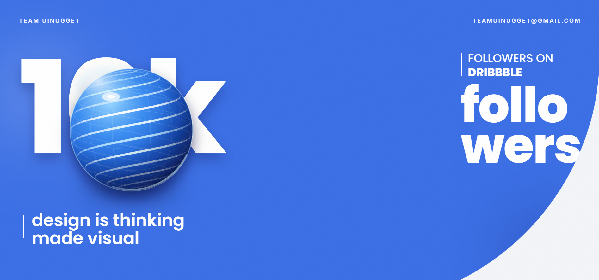
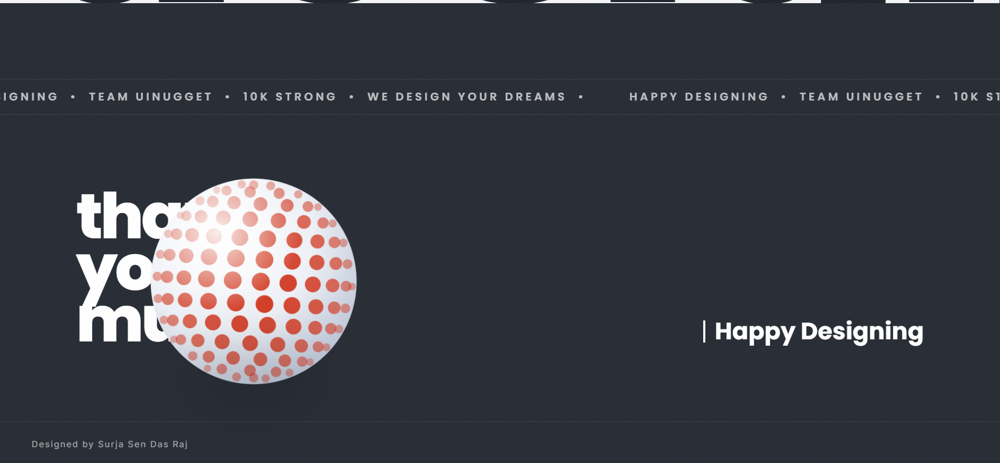

# Design 2

A refined React + Vite frontend design demo with animated spherical visuals and a polished product presentation.

## Overview

This project showcases a slick landing page concept with:

- React 19
- Vite 7
- TypeScript
- Tailwind CSS 4
- Floating 3D-style visuals via custom React components
- Responsive layout with clean spacing and bold typography

The design is built around interactive spheres and a modern studio-style hero screen.

## Run locally

1. Install dependencies:

```bash
npm install
```

2. Start the development server:

```bash
npm run dev
```

3. Open the URL shown in the terminal.

## Public images

The following preview images are available in the `public` folder:





## Project structure

- `index.html` — HTML entry point
- `src/` — React app source files
- `src/components/` — custom UI components for sphere visuals and reveal effects
- `public/` — static image assets
- `vite.config.ts` — Vite configuration with Tailwind plugin
- `tsconfig.json` — TypeScript configuration

## Notes

This design is ideal for showcasing a modern digital brand or creative portfolio. The `public` images are used to preview the interface and can be updated with additional visual assets as needed.
