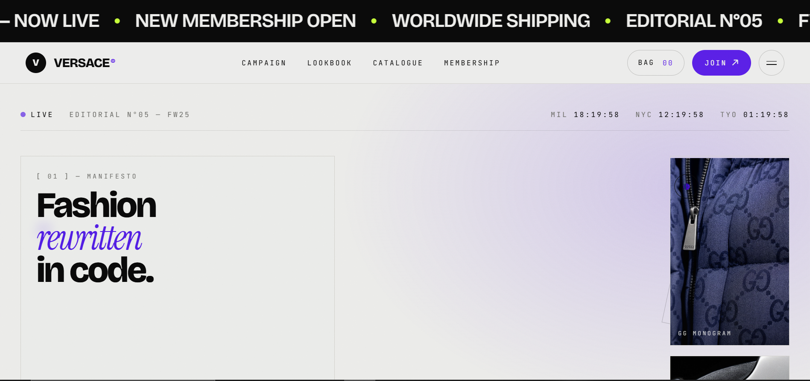
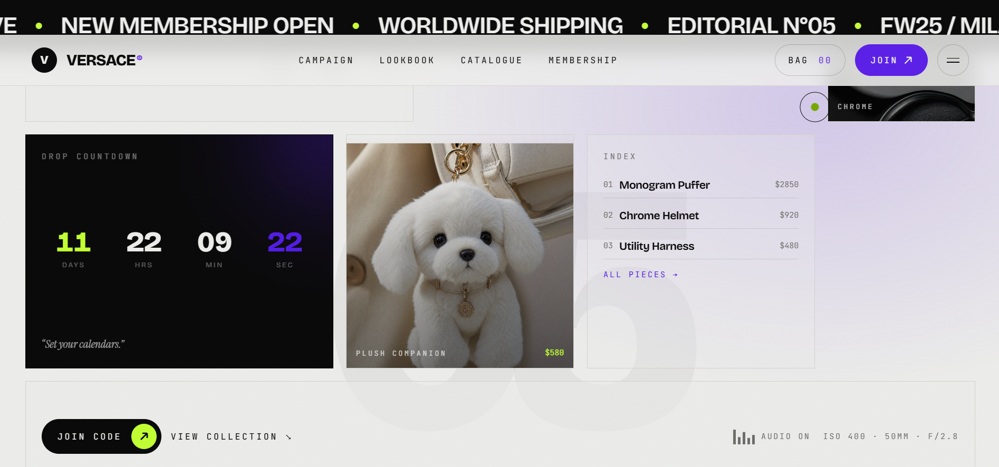
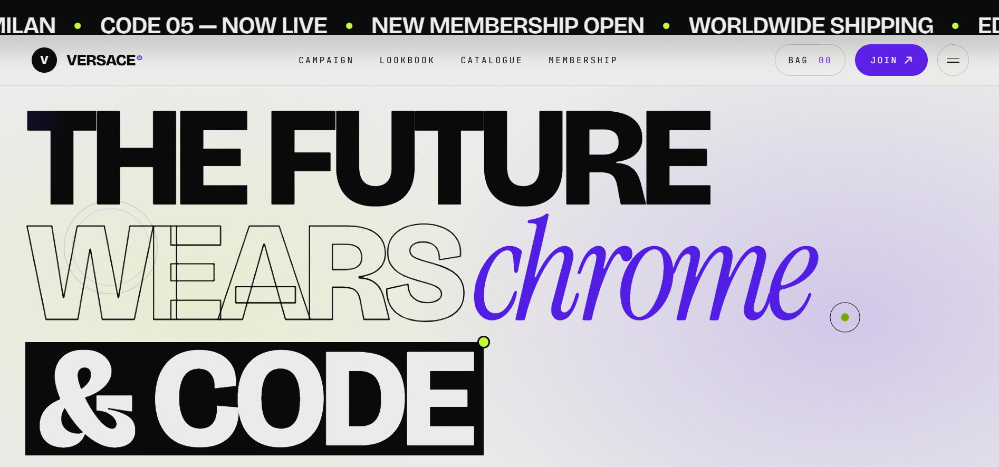
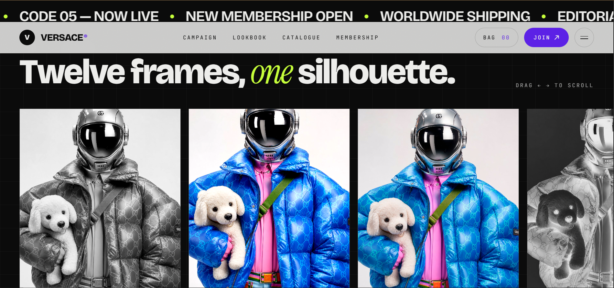
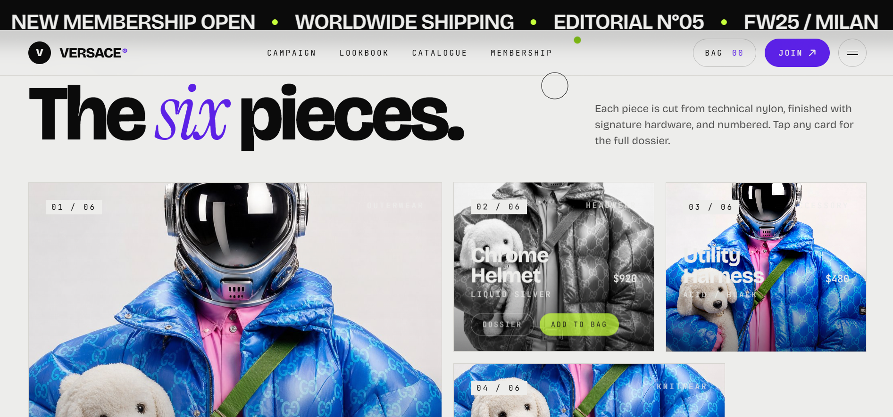
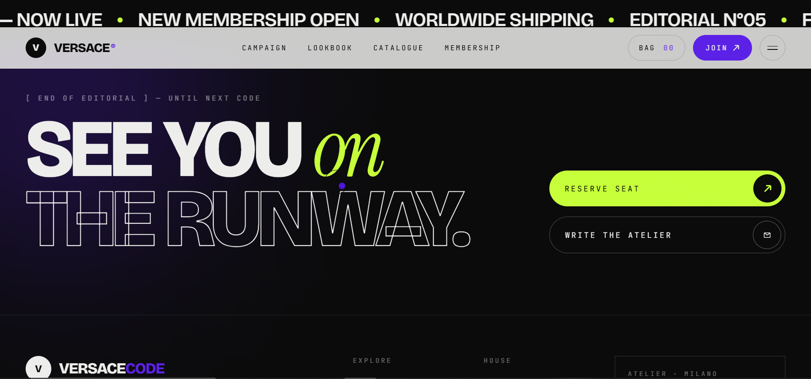

# Design 1

A modern React + Vite landing page design with Tailwind CSS styling and visual product presentation.

## Overview

This project is a polished frontend design prototype built with:

- React 19
- Vite 7
- TypeScript
- Tailwind CSS 4
- `vite-plugin-singlefile` for single-file production bundles

The layout is intended for a luxury fashion editorial experience with rich imagery, bold typography, and subtle animations.

## Run locally

1. Install dependencies:

```bash
npm install
```

2. Start the development server:

```bash
npm run dev
```

3. Open the local URL shown in the terminal.

## Preview Images

The images below are available in the `public` folder and referenced directly by this README.

### Main Design Screenshots













## Project structure

- `index.html` — application shell
- `src/` — React application source
- `public/` — static assets and image files
- `vite.config.ts` — Vite configuration
- `tsconfig.json` — TypeScript settings

## Notes

The design uses clean utility classes and component-driven layout principles. Images are served from the `public` directory and will load automatically when the app is running.
