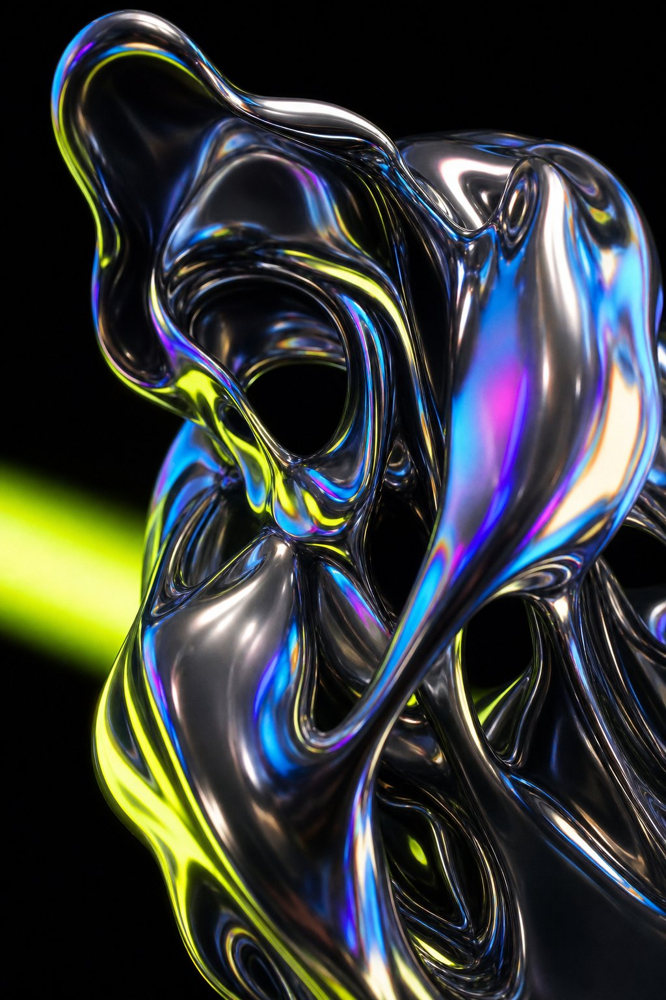

# PixelAI

PixelAI is a high-end, animated product landing page concept for a creative AI studio. The experience blends cinematic visuals, motion-rich storytelling, and a polished editorial layout to present a futuristic image-generation workflow.

## What this project includes

- A bold hero section with layered motion and animated typography
- A gallery-driven showcase inspired by AI-generated visual art
- A manifesto and process section that explain the creative workflow
- A polished studio modal for entering prompts and exploring the concept
- Responsive, modern styling with React, TypeScript, Vite, GSAP, and Tailwind-inspired utility classes

## Tech stack

- React 19
- TypeScript
- Vite
- GSAP for scroll and motion effects
- CSS-based visuals and custom UI styling

## Project structure

- src/App.tsx - main page layout and interactive experience
- src/components/Ribbon.tsx - animated ribbon component used for the scrolling motion graphic
- public/images - visual assets used throughout the interface

## Run locally

1. Install dependencies:
   ```bash
   npm install
   ```
2. Start the development server:
   ```bash
   npm run dev
   ```
3. Open the local Vite URL in your browser.

## Build for production

```bash
npm run build
```

## Preview images





